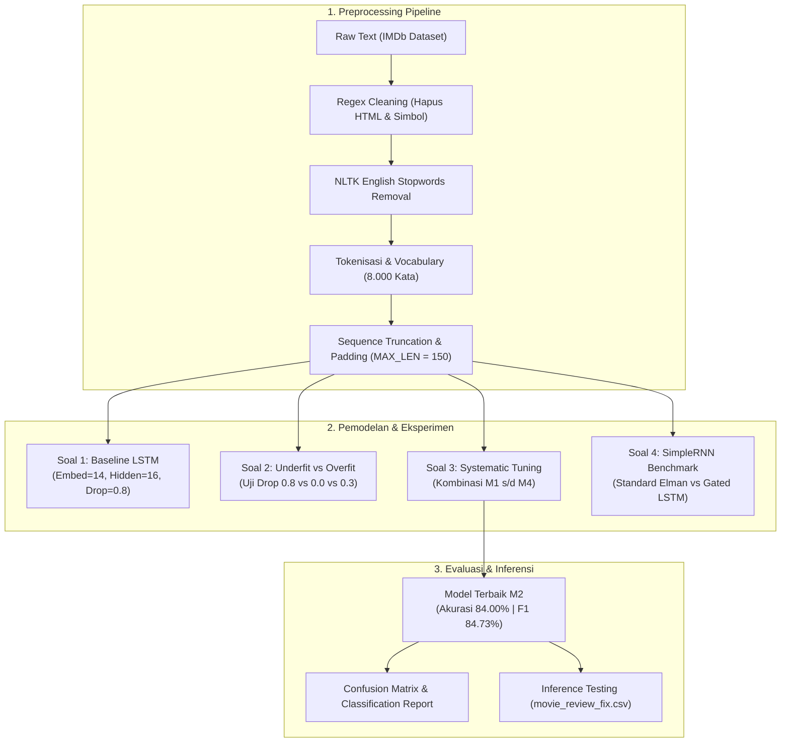

# Praktikum 10 — Long Short-Term Memory (LSTM) & Recurrent Neural Networks (RNN)
## **NLP Sentiment Analysis: Analisis Sentimen Ulasan Film IMDb Menggunakan LSTM & Komparasi Head-to-Head SimpleRNN**

[](https://www.python.org/)
[](https://pytorch.org/)
[](https://jupyter.org/)
[](https://www.pens.ac.id/)

---

## 📌 Identitas & Deskripsi Penugasan

* **Nama Mahasiswa**: Mochammad Ilham Fadillah
* **NRP**: 3324600041
* **Mata Kuliah**: Neuro Computing / Kecerdasan Komputasional
* **Modul Rujukan**: `10. Long Short Term Memory (Praktikum).pdf` (Assignment #10 — Halaman 19)
* **Dataset Utama**:
  * `Data/IMDB/IMDB Dataset.csv` (50.000 ulasan film IMDb berlabel biner: *positive* dan *negative*)
  * `Data/IMDB/movie_review_fix.csv` (Dataset ulasan independen untuk pengujian inferensi data riil)

---

## 🎯 Ruang Lingkup Penyelesaian Assignment #10

Repositori ini berfokus langsung menyelesaikan seluruh penugasan resmi pada **Assignment #10**:
1. **Soal 1 (Eksperimen Klasifikasi Teks)**: Implementasi arsitektur LSTM untuk klasifikasi sentimen biner pada dataset IMDb.
2. **Soal 2 (Pencegahan Underfitting & Overfitting)**: Analisis diagnostik terhadap parameter baseline modul (*Dropout 0.8* dan *Embedding Dim 14*) serta penyesuaian parameter untuk menjaga stabilitas generalisasi.
3. **Soal 3 (Systematic Grid Search / Hyperparameter Tuning)**: Eksplorasi kombinasi parameter arsitektur untuk memaksimalkan metrik evaluasi (*Accuracy*, *Precision*, *Recall*, *F1-Score*, dan *Confusion Matrix*).
4. **Soal 4 (Komparasi Head-to-Head SimpleRNN vs LSTM)**: Membandingkan kinerja SimpleRNN dan LSTM pada arsitektur dan data yang sama, mencakup dinamika konvergensi loss/akurasi, durasi komputasi training, performa metrik, serta elaborasi teoretis terhadap masalah *Vanishing Gradient*.
5. **Real-World Inference & Validasi Data Baru**: Pengujian model terbaik pada sampel ulasan independen `movie_review_fix.csv` dan kalimat uji kustom dengan latensi inferensi 1–4 ms per sampel.

---

## 🧠 Arsitektur & Alur Kerja Komputasi



---

## 📊 Hasil Eksperimen & Analisis Metrik

### 1. Soal 1: Evaluasi Arsitektur Baseline Modul
* **Konfigurasi Baseline**: `Embedding Dim = 14`, `LSTM Units = 16`, `Dropout = 0.8`, `Adam (lr=0.003)`, `5 Epoch`.
* **Hasil Evaluasi Data Uji**:
  * **Akurasi**: **73.70%**
  * **Precision**: **77.62%**
  * **Recall**: **66.60%**
  * **F1-Score**: **71.69%**
  * **Durasi Training**: **5.00 detik**

---

### 2. Soal 2: Analisis Diagnostik Underfitting vs Overfitting
* **Diagnosis Masalah Baseline**:
  * **Dropout 0.8 Terlalu Agresif**: Membuang 80% aktivasi sinyal representasi kata menyebabkan *severe underfitting* (*capacity choking*). Jaringan kehilangan informasi semantik mendasar pada setiap *forward pass*.
  * **Embedding Dimensi 14 Terlalu Sempit**: Menjadi *information bottleneck* untuk kosakata teks ulasan film sebesar 8.000 kata unik.
* **Perbandingan 3 Skenario Regulasi**:
  1. *Underfitting (Baseline)*: Loss tertahan tinggi (>0.60) dan recall rendah (66.60%).
  2. *Overfitting Risk (Dropout 0.0, Dimensi 64)*: Train loss anjlok tajam (<0.20), namun celah generalisasi (*generalization gap*) melebar >0.35 dan rawan menghafal derau.
  3. *Optimal Balanced (Dropout 0.3, Dimensi 64/32)*: Penurunan train dan val loss harmonis dengan celah generalisasi yang rapat dan stabil.

---

### 3. Soal 3: Systematic Parameter Tuning / Grid Search

Hasil pengujian pada data uji (*Holdout Test Set* 1.000 sampel seimbang):

| Model | Embedding Dim | Hidden Units | Dropout Rate | Accuracy (%) | Precision (%) | Recall (%) | F1-Score (%) | Training Time (s) |
| :--- | :---: | :---: | :---: | :---: | :---: | :---: | :---: | :---: |
| **M1: Baseline Modul** | 14 | 16 | 0.8 | 73.70% | 77.62% | 66.60% | 71.69% | 5.00s |
| **M2: Compact Tuned (TERBAIK)** | **32** | **32** | **0.3** | **84.00%** | **81.02%** | **88.80%** | **84.73%** | **7.41s** |
| **M3: Balanced Optimal** | 64 | 32 | 0.3 | 81.30% | 87.53% | 73.00% | 79.61% | 10.41s |
| **M4: High Capacity** | 64 | 64 | 0.4 | 82.10% | 77.07% | 91.40% | 83.62% | 13.52s |

> **Model Terbaik Terpilih: M2 (Compact Tuned)**
> Mencapai **Akurasi 84.00%** dan **F1-Score 84.73%** dengan daya tangkap positif (*Recall*) tertinggi (88.80%) serta efisiensi waktu komputasi yang sangat cepat (7.41 detik).

---

### 4. Soal 4: Komparasi Head-to-Head SimpleRNN vs LSTM

Pengujian dilakukan secara adil (*fair benchmark*) dengan kapasitas arsitektur setara (`Embedding=64`, `Hidden=32`, `Dropout=0.3`, Adam lr=0.003, 5 Epoch):

| Aspek Komparasi | LSTM (Gated Memory) | SimpleRNN (Standard Elman) | Analisis Keunggulan |
| :--- | :---: | :---: | :--- |
| **Test Accuracy** | **84.00%** (M2) / 81.30% (M3) | 82.40% | LSTM lebih tangguh menangkap ketergantungan teks panjang |
| **Test F1-Score** | **84.73%** (M2) / 79.61% (M3) | 82.19% | Keseimbangan prediksi positif/negatif LSTM lebih tinggi |
| **Stabilitas Konvergensi** | Stabil menurun | Mulai mengalami divergensi/overfitting di epoch 5 (Val Loss naik ke 0.4795) | Mekanisme *gate* LSTM menyaring derau sekuensial |
| **Durasi Komputasi CPU** | **7.41s** (M2) / **10.40s** (M3) | **15.32s** | LSTM 51% lebih cepat berkat optimasi paralelisasi tensor modern |

#### Mengapa LSTM Mengungguli SimpleRNN? (Analisis Konseptual)
* **SimpleRNN Mengalami Vanishing Gradient**: Pada kalimat ulasan yang panjang, hidden state ditimpa berulang kali di setiap langkah kata. Gradien eror menyusut mendekati nol saat propagasi mundur, sehingga jaringan melupakan kata-kata penting yang berada di awal atau tengah kalimat ulasan.
* **LSTM Memiliki Mekanisme Gating & Cell State**: LSTM memisahkan jalur memori jangka panjang (*Cell State*) yang dikontrol secara selektif oleh tiga gerbang (*forget, input, output*). Jalur penjumlahan linier ini memungkinkan sinyal gradien mengalir lancar melintasi ratusan kata tanpa hambatan, menjaga pemahaman konteks ulasan film secara utuh.

---

### 5. Hasil Pengujian Inferensi Data Nyata (`movie_review_fix.csv`)

Model terbaik M2 diuji pada ulasan riil dengan latensi inferensi rata-rata **1.0 – 4.5 ms per sampel**:
* *"This movie was an absolute masterpiece with phenomenal acting and breathtaking visuals!"* $\rightarrow$ **POSITIF** (Keyakinan: 71.33%)
* *"Terrible screenplay, dull characters, and the worst directing I have witnessed in years."* $\rightarrow$ **NEGATIF** (Keyakinan: 99.95%)
* *"I had high expectations, but it turned out to be utterly boring and a total waste of money."* $\rightarrow$ **NEGATIF** (Keyakinan: 99.70%)

---

## 📁 Struktur Berkas Repositori

```text
├── Data/
│   └── IMDB/
│       ├── IMDB Dataset.csv          # Dataset ulasan film IMDb (50.000 ulasan)
│       └── movie_review_fix.csv      # Dataset ulasan independen pengujian inferensi
├── Praktikum_10_LSTM_Sentiment_Analysis.ipynb  # Notebook solusi lengkap Assignment #10 (Executed)
├── .gitignore                        # Konfigurasi pengabaian berkas sementara
└── README.md                         # Dokumentasi teknis komprehensif
```

---

## 🚀 Panduan Menjalankan Notebook (*Quickstart*)

1. **Clone Repositori**:
   ```bash
   git clone https://github.com/YonoBengkel/LSTM2.git
   cd LSTM2
   ```

2. **Instalasi Dependensi**:
   ```bash
   pip install torch torchvision torchaudio --index-url https://download.pytorch.org/whl/cpu
   pip install pandas numpy matplotlib seaborn scikit-learn nltk jupyter
   ```

3. **Buka dan Jalankan Notebook**:
   ```bash
   jupyter notebook Praktikum_10_LSTM_Sentiment_Analysis.ipynb
   ```
