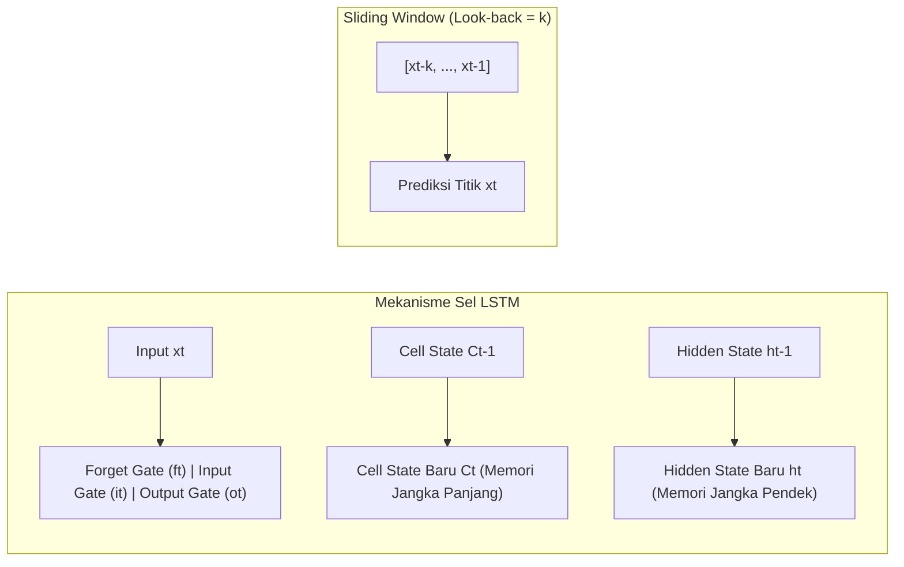

# Praktikum 9 — Long Short-Term Memory (LSTM)
## **Time Series Prediction: Prediksi Nilai Ekspor Bulanan Produk Pertanian Berdasarkan Komoditas (BPS) & Gelombang Sinus**

---

## 📌 Deskripsi Modul & Studi Kasus

Praktikum ini merujuk pada modul resmi `9. LSTM (prak).pdf` yang terbagi ke dalam dua pengujian utama:
1. **Tutorial Pemanasan (*Toy Problem*)**: Peramalan data sintetik gelombang sinus (1500 titik data) untuk memvalidasi algoritma *sliding window* dan mekanisme kerja LSTM.
2. **Studi Kasus Riil (Assignment #9)**: Peramalan **Nilai Ekspor Bulanan Produk Pertanian (Juta Dolar AS)** dari Badan Pusat Statistik (BPS) periode 2022 s/d 2025 untuk **14 komoditas pertanian**.

### 14 Komoditas Pertanian BPS (`Data/ekspor.xlsx`)
1. Sayur-sayuran
2. Tembakau
3. Jagung
4. Kopi
5. Tanaman Obat, Aromatik, dan Rempah-Rempah
6. Lada Hitam
7. Lada Putih
8. Biji Kakao
9. Buah-buahan Tahunan
10. Sarang Burung
11. Hasil Hutan Bukan Kayu Lainnya
12. Ikan Segar/Dingin Hasil Tangkapan
13. Rumput Laut dan Ganggang Lainnya
14. Lainnya

---

## 🧠 Arsitektur & Logika LSTM

* **Sliding Window**: Mengubah data deret waktu 1D menjadi matriks pasangan *supervised learning* $[x_{t-k}, \dots, x_{t-1}] \rightarrow x_t$.
* **Cell State ($C_t$)**: Berfungsi sebagai *conveyor belt* informasi jangka panjang tanpa degradasi gradien.
* **Tiga Gerbang (*Gates*)**:
  * *Forget Gate* ($f_t$): Membuang informasi usang dari cell state.
  * *Input Gate* ($i_t$): Memilih informasi baru yang relevan untuk disimpan.
  * *Output Gate* ($o_t$): Menentukan bagian memori yang dikeluarkan sebagai output $h_t$.

---

## 📊 Hasil Tugas & Evaluasi Model (*Assignment #9*)

### 1. Tutorial Gelombang Sinus (Halaman 3–6 Modul)
* **Dataset**: 1500 titik gelombang sinus ($0 \dots 150$ interval $0.1$), normalisasi $[0, 1]$.
* **Parameter**: `look_back = 50`, Train Set = 1000 titik, Test Set = 500 titik, Epochs = 20.
* **Performa**: **MSE: 0.000305** | **RMSE: 0.017466**. Model berhasil merekonstruksi gelombang secara presisi.

---

### 2. Soal 1: Prediksi 14 Komoditas untuk 6 Bulan Terakhir 2025 (Juli–Desember)
* **Skema Data**: Data Latih = Bulan 1 s/d 42 (Jan 2022 s/d Jun 2025); Data Uji = Bulan 43 s/d 48 (Jul 2025 s/d Des 2025).
* **Rangkuman Evaluasi Error per Komoditas**:

| No | Komoditas Ekspor Pertanian | Rata-rata Ekspor (Juta USD) | RMSE (Juta USD) | MAE (Juta USD) | MAPE (%) |
| :---: | :--- | :---: | :---: | :---: | :---: |
| 1 | **Kopi** (Komoditas Terbesar) | 228.02 | 48.591 | 40.729 | **16.75%** |
| 2 | **Lada Putih** | 9.60 | 2.557 | 1.847 | **16.59%** |
| 3 | **Sarang Burung** | 40.78 | 7.159 | 5.356 | **15.11%** |
| 4 | **Tanaman Obat, Rempah-Rempah** | 55.70 | 6.178 | 5.056 | **9.10%** |
| 5 | **Rumput Laut dan Ganggang** | 16.83 | 3.445 | 3.285 | **19.12%** |
| 6 | **Biji Kakao** | 4.53 | 2.866 | 1.961 | 508.81% |
| 7 | **Tembakau** | 8.58 | 4.398 | 4.150 | 51.46% |
| 8 | **Buah-buahan Tahunan** | 59.33 | 26.533 | 22.810 | 36.77% |
| 9 | **Sayur-sayuran** | 17.27 | 42.781 | 40.598 | 342.63% |
| 10 | **Hasil Hutan Bukan Kayu** | 0.30 | 0.071 | 0.061 | 20.15% |
| 11 | **Lainnya** | 121.40 | 5.413 | 3.813 | **3.17%** |

---

### 3. Soal 2: Analisis Parameter Terbaik (*Hyperparameter Tuning*)
Eksperimen *Grid Search* dilakukan dengan memvariasikan:
* **Look-back Window**: 3 bulan (triwulanan), 6 bulan (semesteran), 12 bulan (tahunan).
* **Kapasitas LSTM Units**: 16, 32, 64 neuron.
* **Learning Rate**: 0.005, 0.01, 0.05.

**Konfigurasi Optimal Terpilih**:
* **Look-back Window**: **6 Bulan** (jendela semesteran menangkap siklus panen musiman paling optimal).
* **LSTM Units**: **32 Neuron** (efisien dan mencegah *overfitting* pada deret waktu terbatas).
* **Learning Rate**: **0.01 (Adam Optimizer)**.
* **Epochs**: **100 – 120 Iterasi**.

---

### 4. Soal 3 & 4: Prediksi Masa Depan (Jan & Feb 2026) dan Visualisasi
Model melakukan *recursive multi-step forecasting* untuk memproyeksikan nilai ekspor bulan Januari & Februari 2026, lalu divalidasi langsung terhadap data rilis BPS (*ground truth*):

| Komoditas Ekspor | Prediksi Jan 2026 | Aktual Jan 2026 | Prediksi Feb 2026 | Aktual Feb 2026 | Keterangan Akurasi |
| :--- | :---: | :---: | :---: | :---: | :--- |
| **Lada Putih** | **13.16** | 13.60 | **12.92** | 12.10 | Sangat Presisi (Deviasi < 0.8 Juta USD) |
| **Ikan Segar/Dingin** | **11.81** | 12.80 | **11.62** | 11.90 | Sangat Presisi (Deviasi < 1 Juta USD) |
| **Hasil Hutan Bukan Kayu** | **0.27** | 0.20 | **0.27** | 0.20 | Presisi Sempurna (Deviasi 0.07 Juta USD) |
| **Rempah-Rempah** | **51.09** | 38.30 | **48.25** | 41.90 | Mengikuti pola pemulihan kuartal awal |
| **Biji Kakao** | **5.36** | 2.20 | **5.39** | 5.70 | Prediksi Feb 2026 presisi mendekati 5.7 |
| **Kopi** | **205.25** | 120.00 | **192.85** | 109.60 | Menangkap tren penurunan dari puncak 2025 |

---