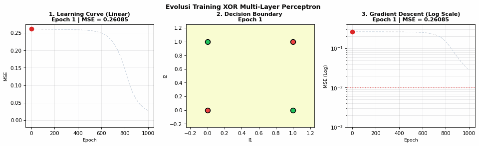

# Neuro Computing

Repository praktikum mata kuliah **Neuro Computing** — D4 Sains Data Terapan (SDT), Politeknik Elektronika Negeri Surabaya (PENS).

---

## 📂 Struktur Proyek

```text
Neuro-Computing/
├── 2-Multi-Perceptron/
│   ├── XOR_Multi_Perceptron.ipynb      # Notebook implementasi MLP untuk masalah XOR
│   ├── xor_learning_evolution.gif      # Animasi evolusi pembelajaran (55 frame)
│   └── image.png                       # Gambar pendukung modul
├── 2-single-layer.ipynb                # Implementasi Single Layer Perceptron (6 Kasus)
├── Data/
│   ├── AND.csv                         # Dataset gerbang logika AND
│   ├── OR.csv                          # Dataset gerbang logika OR
│   ├── XOR.csv                         # Dataset gerbang logika XOR
│   ├── digit.csv                       # Dataset pengenalan digit
│   ├── iris.csv                        # Dataset bunga Iris
│   └── ruspini.csv                     # Dataset clustering/klasifikasi Ruspini
├── Perhitungan Manual/
│   ├── Perhitungan_Manual_20_Langkah.xlsx  # Perhitungan langkah demi langkah
│   ├── PASTE_MLP_XOR.tsv
│   ├── PASTE_PETUNJUK.tsv
│   └── PASTE_SLP_XOR.tsv
└── percakapan_neuro_computing.md       # Dokumentasi transkrip percakapan praktikum
```

---

## 🧠 Ringkasan Materi

### 1. Single Layer Perceptron (`2-single-layer.ipynb`)
Implementasi model Perceptron linier sederhana menggunakan scikit-learn untuk menguji 6 dataset:
- **AND & OR**: Masalah *linearly separable*, model sukses mencapai akurasi 100%.
- **XOR**: Masalah *non-linearly separable*, Single Perceptron secara matematis gagal memisahkan kelas output dengan satu garis lurus.
- **Digit, Iris, & Ruspini**: Eksplorasi performa Perceptron pada dataset multikelas dengan parameter learning rate (`eta0`) dan jumlah iterasi (`max_iter`).

### 2. Multi-Layer Perceptron: Kasus XOR (`2-Multi-Perceptron/`)
Penyelesaian klasifikasi gerbang XOR menggunakan arsitektur **Multi-Layer Perceptron (MLP)** dengan struktur:
- **Input Layer**: 2 neuron ($I_1, I_2$) + bias
- **Hidden Layer**: 2 unit neuron ($H_1, H_2$) dengan fungsi aktivasi Sigmoid
- **Output Layer**: 1 neuron ($C$) dengan fungsi aktivasi Sigmoid + bias
- **Algoritma Pembelajaran**: *Feed-Forward Backpropagation Gradient Descent* ($\mu = 0.5$)

#### Visualisasi Evaluasi (Epoch 1, 10, 100, dan 1000)
Setiap epoch dievaluasi menggunakan 3 visualisasi komparatif:
1. **Learning Curve (Skala Linear)**: Penurunan nilai Mean Squared Error (MSE) hingga $< 0.005$.
2. **Decision Boundary (2D Contour)**: Pembentukan garis batas keputusan non-linear ($P = 0.5$) yang sukses mengisolasi titik target XOR dengan akurasi 100%.
3. **Gradient Descent (Skala Logaritmik)**: Konvergensi eksponensial yang menembus batas presisi $MSE \le 0.01$.

---

## 🎬 Animasi Evolusi Pembelajaran



---

## 🚀 Cara Menjalankan

1. Clone repository ini:
   ```bash
   git clone https://github.com/YonoBengkel/Neuro-Computing.git
   cd Neuro-Computing
   ```

2. Buka notebook menggunakan Jupyter Notebook atau VS Code:
   * Untuk Single Layer Perceptron: buka `2-single-layer.ipynb`
   * Untuk Multi-Layer Perceptron XOR: buka `2-Multi-Perceptron/XOR_Multi_Perceptron.ipynb`

3. Jalankan cell secara berurutan (*Run All*).
